# Awesome Data Center Infrastructure Management (DCIM) 🏢⚡

  

  
  
  
  
  
  

---

## 🌟 Top Data Center Infrastructure Management (DCIM) Ecosystem

**Curated List of SaaS Platforms & Open-Source Infrastructure Software**  
*Comprehensive directory for Data Center Asset Tracking, Rack Elevations, Cable Management, Power Monitoring, Thermal Capacity Planning & Infrastructure Visualization.*

> **Data Center Infrastructure Management (DCIM)** integrates IT assets, facilities management, electrical distribution (PDUs, UPSs), and HVAC thermal controls into a single authoritative source of truth. DCIM software prevents mission-critical downtime, accelerates hardware change management, minimizes stranded capacity, and ensures energy efficiency compliance (PUE, carbon tracking, and EU Energy Efficiency Directive standards).

---

## 📑 Table of Contents
- [🌐 Sector Overview & Market Dynamics](#-sector-overview--market-dynamics)
- [☁️ SaaS & Hosted DCIM Platforms](#️-saas--hosted-dcim-platforms)
- [💻 Open-Source GitHub Projects](#-open-source-github-projects)
- [🔧 Additional Specialized Infrastructure Tools](#-additional-specialized-infrastructure-tools)
- [🤝 How to Contribute](#-how-to-contribute)
- [💖 Support & Sponsorship](#-support--sponsorship)
- [📈 Star History](#-star-history)
- [⚠️ Disclaimer](#️-disclaimer)

---

## 🌐 Sector Overview & Market Dynamics

The global Data Center Infrastructure Management (DCIM) market is valued at approximately **$3.5 billion to $4.3 billion** and is projected to expand past **$12 billion by the early 2030s** at an estimated CAGR of **15% to 18%**, accelerated by massive AI compute density, liquid cooling deployments, and ESG energy compliance requirements. The industry exhibits **moderate fragmentation with high concentration at the top physical infrastructure tier**—dominated by multinational power and thermal giants (Schneider Electric, Vertiv, Eaton, ABB) that lock in facility hardware—alongside a vibrant, fragmented tier of specialized independent software vendors (ISVs) and open-source platforms competing for vendor-agnostic IT monitoring, digital twins, and network automation.

---

## ☁️ SaaS & Hosted DCIM Platforms

| Product | Description | Company Size (Revenue / Valuation) | Pricing (Starting) | Free Tier / Trial Limits |
|---------|-------------|-----------------------------------|-------------------|--------------------------|
| **[Schneider Electric EcoStruxure IT](https://www.se.com/)** | Cloud-based DCIM with two tiers: **IT Expert** for real-time monitoring of Schneider and third-party devices; **IT Advisor** for asset management, capacity planning, and digital twin modeling across on-premises, hybrid, and colocation environments. AI-driven predictive maintenance and anomaly detection built in. | €38.2B+ (~$41B) FY24 revenue / ~€140B ($150B+) market cap | $56.00 to $85.00/node/year (IT Expert 1-Year baseline SKU: SWITE1YR-DIGI; 25-node bundle min ~ $1,400/yr) | 30-day free trial (Full-featured access to cloud platform, live dashboards, multi-vendor device monitoring, and smart alarming) |
| **[Vertiv Trellis](https://www.vertiv.com/)** | DCIM platform focused on power, thermal, and capacity management across physical infrastructure. Integrates with Vertiv power systems and Avocent appliances. | $8.01B FY24 ($10.23B FY25) revenue / ~$43B–$63B market cap | $15,000 baseline bundle (Trellis Quick Start Monitoring entry package for ~30 Floor Mounted Devices including appliance gateway) | Formal evaluation license via sales inquiry (Proof of Concept sandbox typically provisioned for 14–30 days upon qualification) |
| **[Panduit SmartZone](https://www.panduit.com/)** | DCIM focused on physical and power infrastructure—cabinets, cabling, and environmental connectivity. Integrates with SmartZone G5 intelligent PDUs. | ~$1.0B–$1.4B annual revenue (Privately held enterprise) | $15.50/IT asset/year (SmartZone Cloud IT Asset SKU: SZC-ITIA1Y; Power/Facility asset SKU: SZC-PEIA1Y at $78/asset/yr) | Guided live sandbox demo & customized 30-day trial license available via Panduit partner sales |
| **[Device42](https://www.device42.com/)** | Comprehensive IT asset management and DCIM with agentless auto-discovery, dependency mapping, and CMDB capabilities. Tracks physical racks, virtual nodes, and cloud workloads. | $230M valuation (Acquired by Freshworks Inc. [NASDAQ: FRSH, ~$1.4B market cap]) | $1,449/year (Core license tier covering up to 100 devices; add-on modules for ADDM, SLM, and power monitoring priced separately) | 14-day free trial (Limited to discovering and tracking up to 100 devices with core DCIM & IPAM features) |
| **[FNT Command](https://www.fntsoftware.com/)** | Enterprise infrastructure management for data centers, telecommunications, and cable networks. Strong in European markets with integrated CAFM/CAD capabilities. | ~$50M–$100M estimated revenue / 200–250 employees (Privately held enterprise) | €99/user/month billed annually (~€1,188/user/year for entry Asset Inventory CORE; rack-based packages available for DCIM) | Tailored Proof-of-Concept (PoC) evaluation license (14 to 30 days sandbox access with sample datacenter data upon sales consultation) |
| **[Sunbird DCIM](https://www.sunbirddcim.com/)** | Enterprise DCIM with robust 3D digital twin visualizations, rack asset tracking, and capacity management (dcTrack & Power IQ). Spun off from Raritan in 2015. | ~$17M–$18.5M estimated revenue (Privately held enterprise) | $13.99/cabinet/month (~$167.88/cabinet/year for dcTrack Operations; Power IQ monitoring starts at $3.99/monitored node/month) | 30-day free trial (Full access to hosted test environment with 3D rack visualization and capacity analytics) |
| **[netTerrain DCIM](https://www.netterrain.com/)** | DCIM with automated rack layout visualization, cable plant documentation, and environmental reporting by Graphical Networks. | ~$2.4M estimated revenue / 20–25 employees (Privately held, bootstrapped) | $4,926/year (Starting base DCIM subscription tier; netTerrain Logical base entry starts at $944/year) | 14-day free trial (Cloud trial environment limited to a test device set; trial extension available on request) |
| **[Hyperview](https://www.hyperviewhq.com/)** | Cloud-native DCIM with agentless discovery from heterogeneous server, power, and cooling hardware. Simplifies infrastructure visibility and carbon tracking. | ~$2.7M ARR / 20 employees / $300K seed funding (Privately held SaaS) | $3.00/asset/year (Billed annually; minimum purchase requirement of 500 assets = $1,500/year base entry) | 30-day free trial (Full-featured access to cloud platform with unlimited test device discovery and no credit card required) |
| **[Cormant-CS](https://www.cormant.com/)** | DCIM with comprehensive physical layer cable management, connectivity, and asset tracking. Acquired by global facility manager BGIS in 2021. | ~$2.5M estimated revenue (Division of BGIS: ~$1B–$5B gross facility management revenue) | $5,000/year (Starter Pack entry tier supporting 25 to 80 racks with bundled instructor-led setup services; includes unlimited user seats) | 7-day hosted cloud trial (Pre-configured sample data environment; customized Proof-of-Concept PoC licenses provisioned upon request) |
| **[Nlyte Software](https://www.nlyte.com/)** | AI-powered DCIM with outage prediction, what-if capacity planning, and intelligent asset placement. Acquired by Carrier Global Corporation in 2021. | Division of Carrier Global Corp. [NYSE: CARR, ~$40B market cap / $22B+ revenue] (Raised $53.5M prior to acquisition) | $20.00/rack/year baseline nominal entry quote (Custom enterprise contracts typically tiered by total power capacity and managed cabinets) | 14-day free trial (Nlyte On-Demand 2-week guided evaluation environment with sample data and tutorials) |

---

## 💻 Open-Source GitHub Projects

| Project | Star Badge | Description |
|---------|------------|-------------|
| **[NetBox](https://github.com/netbox-community/netbox)** |  | **The world's most widely adopted open-source infrastructure source of truth.** Apache-2.0, Django/Python. Combines IPAM (IP address management) with DCIM (racks, devices, cabling, power) into a unified data model. **Trusted by 10,000+ organizations** including CoreWeave for hyperscale datacenter builds [citation:4]. Plugin architecture enables extensions for floorplan visualization, rack management, and custom workflows [citation:9]. The default choice for network engineers and infrastructure teams needing an API-first, automation-ready platform [citation:11]. |
| **[phpIPAM](https://github.com/phpipam/phpipam)** |  | **Robust, open-source IP address management (IPAM) and rack management tool.** GPLv3, PHP/MySQL. Features full visual rack elevation drawings, subnet calculators, device module tracking, VLAN/VRF management, circuit tracking, and REST API integration for server room and datacenter documentation. |
| **[Ralph](https://github.com/allegro/ralph)** |  | **Full-featured Asset Management, DCIM, and CMDB for data centers and back offices.** Apache-2.0, Django/Python. Tracks asset purchases and lifecycle, provides flexible flow system for asset management, and includes **built-in DC visualization** [citation:5]. Maintained under a "sources only" model by Allegro—source code published and development continuing, but no guaranteed support for pull requests. Live demo available [citation:5]. |
| **[Nautobot](https://github.com/nautobot/nautobot)** |  | **Extensible Network Source of Truth and Data Center Automation Platform.** Apache-2.0, Django/Python by Network to Code. Provides native rack elevation modeling, data center device inventory, structured cabling, Git-backed configuration repositories, and a comprehensive GraphQL and REST API layer for infrastructure-as-code automation. |
| **[NetBox Topology Views](https://github.com/netbox-community/netbox-topology-views)** |  | **Open-source datacenter network & infrastructure topology visualizer.** Apache-2.0. Plugin for NetBox that automatically generates graphical topology diagrams of datacenter racks, switches, server interconnects, and cabling circuits directly from documented NetBox DCIM data. |
| **[RackTables](https://github.com/RackTables/racktables)** |  | **Long-standing open-source datacenter and server room management tool.** GPLv2, PHP/MySQL. Tracks 42U/custom racks, mounted chassis, hardware inventory, network address space, configuration objects, and physical port-to-port cable patching [citation:9]. |
| **[openDCIM](https://github.com/opendcim/openDCIM)** |  | **Free, GPLv3 DCIM application for physical infrastructure management.** PHP-based web application. Covers datacenter inventory management—rack elevations, device tracking, 3-phase power balancing, and space planning—without contending to be a function-by-function replacement for commercial DCIM [citation:2][citation:12]. Provides RESTful API (v4.2+) for integration with asset management platforms like Axonius [citation:6]. Docker and Helm deployment available [citation:2]. |
| **[dcim-list](https://github.com/little-brother/dcim-list)** |  | **Curated list of Data Center Infrastructure Management software and tools.** CC0-1.0. Community reference repository cataloging DCIM suites, monitoring platforms, asset databases, and cable management tools. |

---

## 🔧 Additional Specialized Infrastructure Tools

| Project | Description |
|---------|-------------|
| **[DRACS (Dell Rack & Asset Control System)](https://pypi.org/project/dracs/)** | Python-based tool for managing **Dell server fleets** with warranty tracking, BIOS/iDRAC firmware version monitoring, and SNMP-based discovery. Integrates with Dell TechDirect API for warranty data. Web UI with color-coded alerts for expiring warranties and outdated firmware. **Not general-purpose DCIM**—purpose-built for Dell hardware environments [citation:3][citation:10]. |
| **[Tenqora](https://github.com/topics/rack-management)** | "Operations-first DCIM for racks, assets, connectivity, power and lifecycle" listed on GitHub's rack-management topic. Modern DCIM interface for tracking assets and power chains [citation:9]. |

> **Frameworks for building custom systems**: Choose **NetBox** for network-centric infrastructure with IPAM and a thriving plugin ecosystem, **openDCIM** for straightforward physical rack/device management on standard PHP hosting, and **Ralph** for full asset lifecycle tracking with CMDB and visual DC layout—all deployable via Docker without per-rack or per-node licensing. For Dell-specific fleets, **DRACS** provides warranty and firmware tracking that general DCIM tools may not cover natively [citation:3].

---

## 🤝 How to Contribute

Contributions are warmly welcome! Help make this curated DCIM resource the most accurate and up-to-date guide for operations teams:

1. 🍴 **Fork the repository** on GitHub.
2. 🌿 **Create a descriptive feature branch** (`git checkout -b add-dcim-tool`).
3. 📝 **Add or edit entries in `README.md`** following the existing tabular structure (include product name, verified official URL, starting pricing, trial terms, and concise feature descriptions).
4. ✅ **Ensure factual accuracy** and test all links.
5. 🚀 **Submit a Pull Request** with a brief summary of additions or updates.

⭐ Don't forget to star the repository if you found it useful!

---

## 💖 Support & Sponsorship

Thank you so much for exploring and using this repository! If this curated list helped you evaluate DCIM software, optimize your server room layouts, or build datacenter operations tooling, please consider supporting the project:

- ⭐ **Star this repository** to improve visibility on GitHub.
- 🍴 **Fork and share** with colleagues, DevOps specialists, and data center engineers.
- ☕ **Buy me a coffee & sponsor my work**: Visit the [GitHub Sponsors Dashboard](https://github.com/sponsors/ishandutta2007) to help support continuous curation and maintenance of open-source resources.

Your support is deeply appreciated! 🙌

---

## 📈 Star History

---

## ⚠️ Disclaimer

- This is an **independent, community-curated** list — not an exhaustive catalog and not a commercial endorsement.
- DCIM platforms document critical physical and electrical dependencies; inaccurate data can lead to capacity outages, cooling failures, or electrical overloads. Always validate digital documentation against physical datacenter reality before executing change planning.
- **Open-source DCIM maturity varies**: NetBox is enterprise production-grade with hyperscale adoption [citation:4]. openDCIM is functional but community activity has slowed [citation:12]. Ralph is maintained under a "sources only" model without guaranteed PR support [citation:5]. Commercial DCIM platforms (Schneider Electric, Vertiv, Sunbird, Nlyte) generally operate on structured annual subscriptions and custom enterprise quotes.

---

  <b>Built for data center managers, infrastructure engineers, network architects, and operations developers.</b> 
  <i>Let's make data center infrastructure management more open, documented, and reliable.</i>

